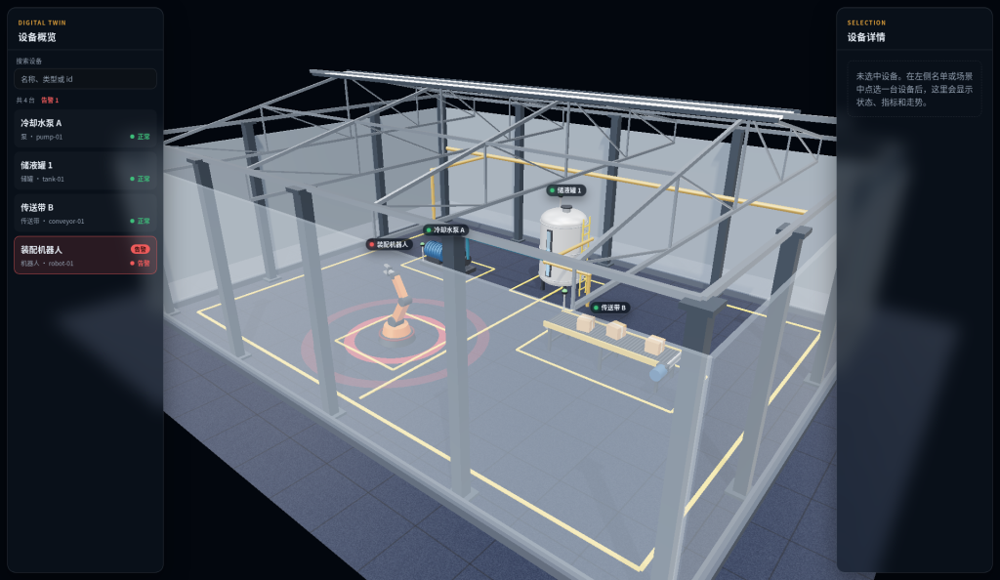

# digital_twin

数字孪生 MVP：浏览器里打开的静态演示页，用仓库里的 Three.js 渲染场景，点选物体后在侧栏查看信息。

## 技术栈

- 纯静态页面（HTML / CSS / JavaScript）
- Three.js 本地 vendor（无 npm）
- **不需要** npm、Node、Docker 或任何构建步骤

## 本地运行

```bash
git clone https://github.com/yellowmeow666/digital_twin.git
cd digital_twin
git checkout feat/digital-twin-mvp
python3 -m http.server 8080
```

浏览器打开 [http://localhost:8080](http://localhost:8080)。

## 怎么演示

1. 打开页面后会看到厂房三维场景。
2. 用鼠标拖拽旋转视角，点选场景里的设备。
3. 右侧侧栏显示当前选中设备的名称、状态和指标；指标约每 2 秒模拟更新。

### 迭代 2 能力

- **名单搜索与点击**：左侧设备名单可搜索，点击名单项即可选中对应设备并高亮。
- **告警状态**：指标越限后设备变色，名单与侧栏显示警告/告警。
- **历史走势**：侧栏展示选中设备指标的历史走势。
- **定位相机**：选中设备后可将相机定位到该设备附近，便于查看。

## 协作说明

开发共用分支：`feat/digital-twin-mvp`。推送前请先 `git pull --rebase`，不要 force push，不要直接推 `main`。

### 迭代 3 · 视觉

这一迭代用本地 vendor 的官方 Three.js addons 提升画面：RoomEnvironment 环境光，EffectComposer/OutlinePass 选中描边与后期，CSS2DRenderer 设备标签。页面仍是静态站点，依赖都在本地 vendor，运行时不需要 npm 或 CDN，用 `python3 -m http.server 8080` 启动。

- **低配模式**：机器较慢时，打开 [http://localhost:8080/?lowfx=1](http://localhost:8080/?lowfx=1)，会关闭选中描边，改用地面选中环和设备本体提亮。
- **自动降级**：没有显卡（软件渲染）或帧率低于 40fps 时，页面会自动关闭描边，效果同低配模式。


